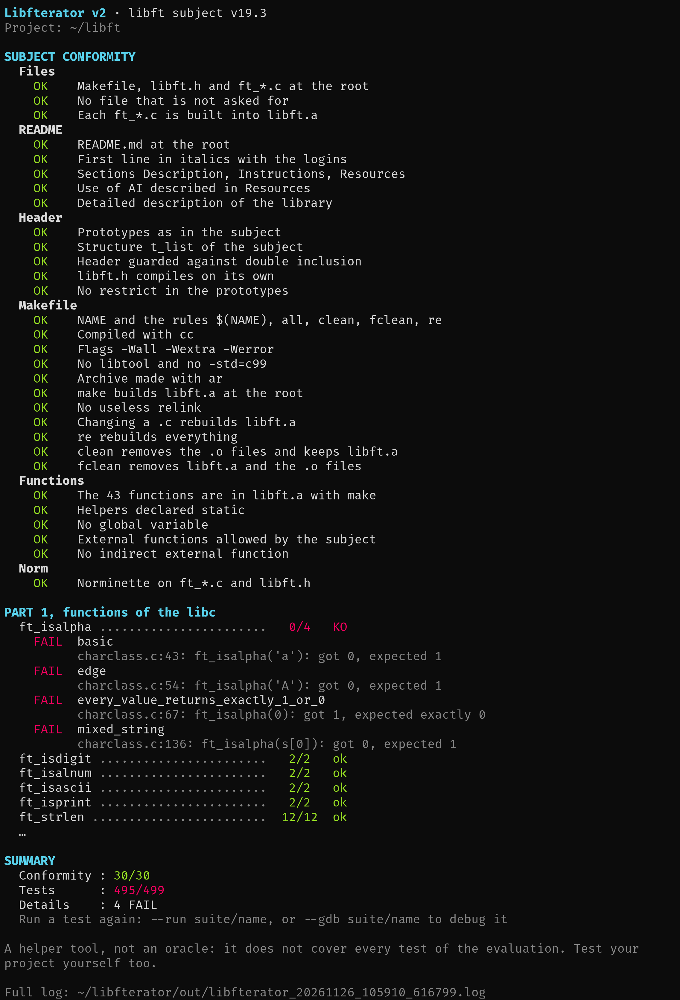

# Libfterator v2

A tester for the libft of 42, up to date with the **subject v19.3**.

```bash
git clone -b v2 https://github.com/Blaeste/Libfterator.git libfterator
cd libfterator
./libfterator /path/to/your/libft
```

Nothing to install if `cc`, `make` and Python 3 are there. Your project is never changed: everything happens on a copy.

<p align="center">
  
</p>

The tester builds once, then runs **499 counted tests** and 40 information cases. A full run with every check of the subject takes about 5 seconds.

The messages are in French by default: `--lang en` gives them in English (42pal passes the language it speaks).

> A helper tool, not an oracle: it does not cover every test of the evaluation. Test your project yourself too.

## What it checks

**The subject** (`SUBJECT CONFORMITY`):

| Group | Checks |
|---|---|
| Files | `Makefile`, `libft.h` and `ft_*.c` at the root, no useless file, each `ft_*.c` compiled |
| README | first line in italics with the logins, sections Description, Instructions, Resources, use of AI, description of the library |
| Header | exact prototypes (including `unsigned int ft_lstsize`), `t_list`, include guard, no `restrict` |
| Makefile | `NAME`, rules, `cc`, `-Wall -Wextra -Werror`, `ar`, no `libtool` and no `-std=c99`, no relink, what `clean`, `fclean`, `re` do |
| Functions | all 43 there with `make` alone, helpers `static`, no globals, external functions allowed function by function |
| Norm | norminette, if it is installed |

Each check gives `OK` or `KO`. `WARN` (a point to look at) and `SKIP` (the check could not be done) do not count in the score.

**The functions** (parts 1, 2 and 3). Each test checks by itself:

- **leaks**, on every test and without valgrind;
- **overflows**, to the byte, thanks to a protected page right after each block: one byte too many stops the test at once;
- **the forgotten terminator**: the memory of `malloc` is filled with a non-zero pattern, so a missing `\0` always shows;
- **double frees, invalid `free`s and accesses after a `free`**;
- **`const` parameters**: the input strings are read-only in the tests concerned.

The functions that allocate are also tested with **each `malloc` failing in turn**: they must return `NULL`, without a leak or a crash.

## Read the result

```
ft_strlcat .......................  13/15  KO
  OOB   dst_not_terminated_within_size
        read 1 byte(s) past the end of a buffer of 5 byte(s)
```

| Status | Meaning |
|---|---|
| `FAIL` | wrong result, with the value got and the value expected |
| `CRASH` | the test crashed, a segfault for example |
| `TIMEOUT` | the test went over the limit (likely an infinite loop) |
| `LEAK` | some memory was not freed |
| `MEMERR` | double free, invalid `free` or write before the start of a block |
| `OOB` | read or write out of bounds, or write into a `const` parameter |
| `MISSING` | function missing from `libft.a` |
| `VALGRIND` | error seen by valgrind (with `--valgrind`) |
| `INTERNAL` | the tester itself could not go on, for example out of system memory |

To run a test again, or open it in gdb:

```bash
./libfterator ../libft --run strlcat/dst_not_terminated
./libfterator ../libft --gdb strlcat/dst_not_terminated_within_size
```

In gdb, type `run`. The run stops on the failing assertion.

## Undefined cases

The subject does not define `ft_strlen(NULL)`, `ft_substr(NULL, 0, 5)` nor an `ft_atoi` beyond an `int`. These cases show in a section of their own, with what your libft does, **without counting in the score**: a protected libft and an unprotected one get the same grade.

```
UNDEFINED CASES, for information (not counted)
  strlen_null ...................... SIGSEGV
  substr_null ...................... returns NULL
```

## Options

| Option | Effect |
|---|---|
| `--run PATTERN` | only the tests whose name holds `PATTERN`, without the checks of the subject |
| `--list` | lists the tests |
| `--verbose` | shows each test |
| `--no-color` | no colors |
| `--timeout S` | limit per test in seconds, 5 by default |
| `--seed N` | seed of the random tests, 42 by default |
| `--no-conformity` | skips the checks of the subject |
| `--no-norm` | skips the norminette |
| `--valgrind` | runs each test again under valgrind (about a minute on 12 cores) |
| `--asan` | builds the libft again with AddressSanitizer and UBSan |
| `--gdb NAME` | opens a test in gdb |
| `--json FILE` | writes the results in JSON |
| `--lang en` | messages in English (French by default) |
| `--stream` | one JSON line per event on the output, as the run goes (for a live display) |
| `--version` | shows the version |

The exit code is `0` if everything passes, `1` if there is a KO and `2` for a wrong use. Each run writes a report in `out/`.

The JSON is for other tools, like [42pal](https://github.com/Blaeste/42pal). It is written even when nothing could run, and its `format` field (`1` today) changes if a field changes meaning:

```json
{"format": 1, "tester": "libfterator", "version": "2.1.0", "lang": "en", "seed": 42,
 "log": "out/libfterator_….log", "error": null, "notes": [],
 "conformity": [{"key": "files.layout", "group": "Files", "label": "…", "status": "OK", "detail": ""}],
 "tests": [{"name": "strlcat/dst_not_terminated", "status": "OOB", "detail": "…", "ms": 3}]}
```

`error` is `{"title", "detail"}` when the tests could not run, or when they stopped before the end (the program that runs them died, or gave fewer results than tests): the results before it are kept, and the run is a KO, never a pass.

With `--stream`, the output gives the same results as the run goes, one JSON line per event: `start`, `step` (`subject`, `build`, `tests`), `check`, `plan` (the number of tests to come), `test` and `error`. The usual report stays in `out/`.

## Requirements

- Linux or WSL: catching `malloc` relies on `ld --wrap`, which macOS lacks
- `cc`, `make`, `ar`, `nm`, Python 3 (tested with 3.10 and 3.13), clang or gcc (tested with clang 12 and gcc 10)
- Optional: norminette, valgrind, gdb

## Add a test

The tests are real C files in `tests/`, and any new `.c` in that folder is compiled by itself. The engine is described in `engine/lft_test.h`.

```c
TEST(strlcpy, truncate)
{
	char	*dest = lft_guard_buf(6);	// one byte too many gives an OOB

	ASSERT_EQ(ft_strlcpy(dest, "Hello World", 6), 11);
	ASSERT_STR(dest, "Hello");
}
```

The first argument of `TEST` is the name of the function without `ft_`. To test the failures of `malloc`:

```c
TEST(strdup, malloc_failure_returns_null)
{
	MALLOC_FAIL_LOOP
	{
		char	*r = ft_strdup("hello");

		if (lft_mf_injected())
			ASSERT_NULL(r);
		else
			free(r);
	}
}
```

To run the tests of the tester itself:

```bash
python3 -m unittest discover -s checks
```

The mapping between the 329 tests of v1 and those of v2 is in [docs/PORTAGE.md](docs/PORTAGE.md) (in French).
